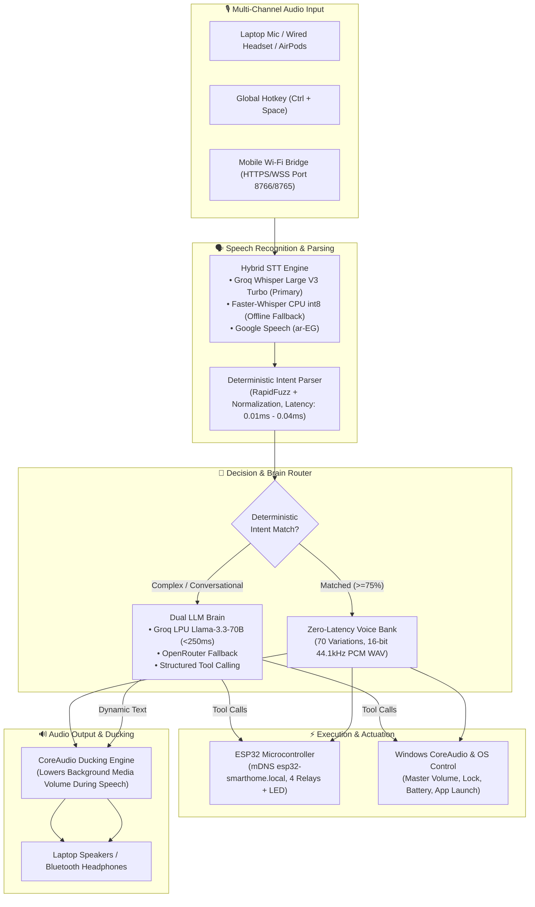

# 🏡 AI-Powered Smart Home Voice Hub (Native Windows Desktop `.exe`)

<div align="center">

[](README_AR.md)
[](README.md)

**A high-performance, native Windows desktop application and IoT hub powered by Egyptian Arabic voice interaction, zero-latency audio caching, Fish Speech CUDA cloning, Groq LPU reasoning, and ESP32 hardware control.**

[](https://www.python.org/)
[](https://riverbankcomputing.com/software/pyqt/)
[](https://pytorch.org/)
[-76B900?style=flat-square&logo=nvidia&logoColor=white)](https://developer.nvidia.com/cuda-toolkit)
[](https://groq.com/)
[-00ADD8?style=flat-square)](https://github.com/fishaudio/fish-speech)
[](https://www.espressif.com/)
[](LICENSE)

[Architecture](#-system-architecture) •
[Key Features](#-key-features) •
[Hardware Specs](#-optimized-hardware-profile) •
[Quick Start](#-quick-start) •
[Voice Bank](#-egyptian-arabic-voice-bank-manifest) •
[ESP32 Guide](#-esp32-firmware--wiring) •
[Screenshots & UI](#-user-interface)

</div>

---

## 📖 Overview

The **AI Smart Home Voice Hub** is a 100% native Windows desktop application built with **PyQt6**, designed to serve as an intelligent, zero-latency ambient computing bridge between your laptop OS, physical smart home devices (via ESP32), and cloud/edge AI models.

Unlike traditional voice assistants that introduce 1.5–3.0 second delays by performing cloud text-to-speech roundtrips for repetitive commands, this system uses a **Dual Voice Synthesis Engine**:
1. **Zero-Latency Audio Cache (0 ms playback):** 70 pre-generated, studio-quality Egyptian Arabic audio variations covering 27 deterministic smart home and PC control intents.
2. **Real-Time Dynamic Neural Synthesis:** Live, contextual responses for battery statistics, CPU load, and open-ended conversational intelligence powered by Groq LPU and local Fish Speech running on the RTX 4050 GPU.

---

## 🏛️ System Architecture



---

## 🌟 Key Features

### 1. 100% Native Windows Desktop Application (`.exe`)
- **No Web Apps / No Browser Popups:** Built directly with **PyQt6** and custom dark-theme QSS stylesheets.
- **Windows System Tray Integration:** Minimizes seamlessly to the system tray (next to the clock) with a background context menu for instant accessibility.
- **Global Hotkey:** Press **`Ctrl + Space`** from any application, game, or window across Windows to trigger listening.
- Standalone compiled binary ready for distribution: `dist\SmartHomeVoiceHub\SmartHomeVoiceHub.exe`.

### 2. Dual Voice Engine: Audio Cache + Dynamic GPU Synthesis
- **Zero-Latency Voice Bank:** 70 studio-quality Egyptian Arabic `.wav` clips categorized into lighting, climate, laptop OS, ESP32 hardware, greetings, and night whispers.
- **Randomized Natural Variations:** 3 to 5 natural phrasing variations per intent (e.g., *"تمام يا فندم، نورت الريسبشن"*, *"من عينيا، النور اشتغل"*) to prevent repetitive machine responses.
- **Auto Night Whisper Mode:** Automatically switches to a quiet, soothing whisper tone after midnight (12:00 AM) or upon voice command.
- **Windows CoreAudio Ducking:** Automatically suppresses background media playback volume (Spotify, YouTube, games) to 25% while the assistant speaks, restoring it immediately after.

### 3. Dual-Provider LLM Brain with Structured Tool Calling
- **Primary Engine:** **Groq LPU** running `llama-3.3-70b-versatile` with reasoning speeds under **250 ms**.
- **Fallback Engine:** **OpenRouter** running `meta-llama/llama-3.3-70b-instruct:free` as a redundant zero-cost backup.
- **Structured Tool Calling:** Directly parses multi-step, compound instructions (e.g., *"اطفي نور الصالة واقفل شاشة اللابتوب وخلي التكييف على 22"*) and dispatches JSON RPC actions to ESP32 and Windows OS controllers simultaneously.

### 4. Hybrid Speech-to-Text (STT)
- **Primary:** Groq Whisper Large V3 Turbo for real-time, accent-tolerant Egyptian Arabic transcription.
- **Local Fallback:** `faster-whisper` quantized to `int8` running entirely offline on the Intel CPU.
- **Third Fallback:** Google Speech Recognition (`ar-EG`).

### 5. Secure Mobile Mic LAN Bridge (HTTPS/WSS)
- Built-in lightweight web portal running on `https://192.168.100.84:8766` with a secure WebSocket server on `wss://192.168.100.84:8765`.
- Generates **cryptographic self-signed SSL certificates** on the fly, unlocking `navigator.mediaDevices.getUserMedia` restrictions in iOS Safari and Android Chrome on local IPs.
- Enables streaming audio from any smartphone or connected AirPods across the entire home Wi-Fi network without external room microphones.

### 6. Physical ESP32 Hardware Integration
- **mDNS Auto-Discovery:** Discovers the IoT node automatically at `http://esp32-smarthome.local`.
- **Zero-Component Out-of-the-Box Testing:** Controls the onboard blue LED (`GPIO 2`) directly.
- **4-Channel Relay Control:** Pre-configured for reception lighting (`GPIO 26`), bedroom lighting (`GPIO 27`), appliances/fan (`GPIO 14`), and blinds/spare (`GPIO 12`).
- **Serial COM Port Fallback:** Operates seamlessly via USB cable if Wi-Fi is temporarily down.

### 7. Deep Windows OS Host Control
- **Master Audio Volume:** Up, Down, Mute, or exact percentage via Windows CoreAudio API (`pycaw`).
- **Media Playback:** Play/Pause, Next Track, Previous Track.
- **Session & Power:** Instant workstation lock (`LockWorkStation`), monitor power-off.
- **Live Telemetry:** Real-time battery charge percentage, AC wall-power status, CPU load, and RAM consumption.
- **Application Launcher:** Voice shortcuts for Google Chrome, Spotify, VS Code, and Notepad.

---

## 💻 Optimized Hardware Profile

Tested and tuned specifically for the **Lenovo LOQ 15IAX9**:

| Component | Specification | Hub Allocation |
| :--- | :--- | :--- |
| **Processor** | Intel Core i5-12450HX (8 cores / 12 threads) | Faster-Whisper CPU STT + Background LAN receiver |
| **Graphics Card** | **NVIDIA GeForce RTX 4050 Laptop GPU (6GB GDDR6)** | **100% VRAM allocated to Fish Speech (`openaudio-s1-mini` fp16 ~3.5GB)** |
| **Memory** | 24 GB DDR5 4800 MHz | PySide6 GUI cache, audio buffers, and OS headroom |
| **OS** | Windows 11 Home 64-bit | CoreAudio API, Windows Media Session, System Tray |
| **CUDA Driver** | CUDA 12.4 / cuDNN 9.x | PyTorch 2.6.0+cu124 acceleration |

---

## 📁 Repository Structure

```
.
├── audio_cache/                    # 70 Pre-generated studio-quality Egyptian WAV files
│   ├── ac_climate/                 # AC set 20, 22, 24, off, curtains, windows
│   ├── esp32_hardware/             # Onboard LED, fan, status query
│   ├── greetings/                  # Greetings, instant acks, identity
│   ├── laptop_control/             # Volume up/down/mute, battery, lock, apps
│   ├── lighting/                   # Reception on/off, bedroom, all lights
│   └── whispers/                   # Late-night whisper responses
├── config/                         # Configuration assets & reference voice seeds
│   ├── app_settings.json           # User configuration (keys, thresholds, engines)
│   ├── phrases_to_generate.json    # Full text & emotion tag voice bank definitions
│   ├── voice_bank_manifest.json    # 27 intents mapped to 70 audio variation paths
│   └── reference_voices/           # Egyptian studio reference seeds for Fish Speech
│       ├── egyptian_male_ref.wav   # Male reference audio seed (Shakir)
│       └── egyptian_female_ref.wav # Female reference audio seed (Salma)
├── core/                           # Backend architecture modules
│   ├── audio_ducking.py            # Windows CoreAudio temporary volume ducking
│   ├── audio_player.py             # Low-latency Pygame/SoundDevice playback
│   ├── esp32_controller.py         # Wi-Fi REST, mDNS discovery & Serial COM fallback
│   ├── fish_speech_client.py       # Fish Speech GPU manager & Egyptian neural fallback
│   ├── intent_parser.py            # 0.01ms deterministic Egyptian Arabic NLP matcher
│   ├── lan_receiver.py             # HTTPS/WSS mobile microphone LAN bridge
│   ├── laptop_controller.py        # Windows volume, battery, lock, process controller
│   ├── llm_brain.py                # Dual Groq LPU + OpenRouter router & tool caller
│   ├── paths.py                    # Path resolution for dev & PyInstaller frozen exe
│   └── stt_engine.py               # Hybrid Groq Whisper + local CPU fallback
├── esp32_firmware/                 # Microcontroller source code
│   └── esp32_smart_home.ino        # Arduino sketch with Wi-Fi, mDNS, and 4 relays
├── gui/                            # Native PyQt6 user interface
│   ├── main_window.py              # Window container, tray icon, hotkeys, status loop
│   ├── styles.py                   # GitHub-style dark theme QSS stylesheet
│   ├── tab_dashboard.py            # Interactive controls, visual console & metrics
│   ├── tab_esp32_devices.py        # Device management, relay toggles & ping tool
│   ├── tab_audio_cache.py          # Voice bank studio, VRAM monitor & voice recorder
│   └── tab_settings.py             # API keys (Groq, OpenRouter, HF), STT & Ducking
├── scripts/                        # Development & testing utilities
│   ├── generate_reference_voices.py# Generates studio reference seeds for cloning
│   ├── pregenerate_voice_bank.py   # Batch generates the 70 Egyptian WAV audio clips
│   ├── setup_fish_gpu.py           # Clones repo & sets up CUDA model on RTX 4050
│   └── test_all_modules.py         # Comprehensive 6-point subsystem test suite
├── app.spec                        # PyInstaller configuration specification
├── build_exe.bat                   # 1-Click build script to produce standalone .exe
├── fish_speech_generator.py        # Standalone audio cache regenerator CLI
├── main.py                         # Application entrypoint
├── requirements.txt                # Python package dependencies
└── start_fish_server.bat           # Launch local Fish Speech GPU server on RTX 4050
```

---

## ⚡ Quick Start

### Prerequisites
- Windows 10/11 64-bit
- Python 3.10+ (Python 3.13 tested)
- Git for Windows
- [FFmpeg](https://ffmpeg.org/) installed and available on system `PATH`
- (Optional for local GPU voice cloning) NVIDIA GPU with CUDA 12.x support

### Installation

1. **Clone the repository:**
   ```bash
   git clone https://github.com/AbdoLailah586/SH_0.git
   cd SH_0
   ```

2. **Create and activate a virtual environment:**
   ```powershell
   python -m venv .venv
   .\.venv\Scripts\activate
   ```

3. **Install core dependencies:**
   ```powershell
   pip install -r requirements.txt
   ```

4. **Install PyTorch with CUDA 12.4 acceleration:**
   ```powershell
   pip install torch --index-url https://download.pytorch.org/whl/cu124
   ```

5. **Run the 6-point diagnostic suite:**
   ```powershell
   python scripts\test_all_modules.py
   ```

6. **Launch the Desktop Application:**
   ```powershell
   python main.py
   ```

---

## 📦 Building Standalone Executable (`.exe`)

Compile the entire application into a standalone Windows binary with one click:

```cmd
build_exe.bat
```

The compiled output will be generated at:
```
dist\SmartHomeVoiceHub\SmartHomeVoiceHub.exe
```
This executable is completely portable and includes all 70 Egyptian Arabic audio clips, QSS stylesheets, reference voice seeds, and configuration assets.

---

## 🎙️ Egyptian Arabic Voice Bank Manifest

| Category | Voice Command Example | Action Executed | Response Mode |
| :--- | :--- | :--- | :--- |
| **Reception Lighting** | *"افتح النور"*, *"نور الريسبشن"*, *"شغل اللمبة"* | Relay 1 Active (GPIO 26) | Instant Cache (0 ms) |
| **Turn Off Lighting** | *"اقفل النور"*, *"اطفي النور"*, *"ضلم الريسبشن"* | Relay 1 Disabled | Instant Cache (0 ms) |
| **Bedroom Lighting** | *"نور الأوضة"*, *"افتح نور غرفة النوم"* | Relay 2 Active (GPIO 27) | Instant Cache (0 ms) |
| **Turn Off Bedroom** | *"اطفي الأوضة"*, *"اقفل نور غرفة النوم"* | Relay 2 Disabled | Instant Cache (0 ms) |
| **All Lighting** | *"نور البيت كله"*, *"اطفي البيت كله"* | Toggle all 4 Relays | Instant Cache (0 ms) |
| **ESP32 Onboard LED** | *"افتح لمبة الاختبار"*, *"شغل ليد البوردة"* | Toggle Blue LED (GPIO 2) | Instant Cache (0 ms) |
| **Climate Control** | *"شغل التكييف على 22"*, *"خلي التكييف 24"* | Update AC Setpoint | Instant Cache (0 ms) |
| **Curtains / Window** | *"افتح الستارة"*, *"افتح الشباك للتهوية"* | Curtain Relay Active | Instant Cache (0 ms) |
| **Laptop Volume** | *"علي الصوت"*, *"وطي الصوت"*, *"اكتم الصوت"* | Windows CoreAudio Master Volume | Instant Cache (0 ms) |
| **Workstation Lock** | *"اقفل اللابتوب"*, *"اقفل الشاشة"* | Invoke `LockWorkStation` | Instant Cache (0 ms) |
| **Battery Percentage**| *"بطارية اللابتوب كام"*, *"نسبة الشحن كام"* | `psutil` Battery Readout | **Dynamic Synthesis with live %** |
| **Media Playback** | *"وقف الأغنية"*, *"شغل الموسيقى"* | Global VK_MEDIA_PLAY_PAUSE | Instant Cache (0 ms) |
| **Application Launch**| *"افتح كروم"*, *"افتح سبوتيفاي"*, *"افتح كود"*| Launch Target Application | Instant Cache (0 ms) |
| **Night Whisper Mode**| *"وضع النوم"*, *"تصبح على خير"* | Lights Off + Soft Tone | Whisper Cache (0 ms) |
| **Open Chat / QA** | *"مين هو مخترع الكهرباء؟"*, *"قوللي نكتة"* | Groq Llama-3.3-70B Reasoning | **Dynamic Neural Voice** |

---

## 📡 ESP32 Firmware & Wiring

The companion firmware is located in [`esp32_firmware/esp32_smart_home.ino`](esp32_firmware/esp32_smart_home.ino).

### Pin Mapping
- **Onboard Status LED:** `GPIO 2`
- **Relay 1 (Reception Light):** `GPIO 26`
- **Relay 2 (Bedroom Light):** `GPIO 27`
- **Relay 3 (Fan / Appliance):** `GPIO 14`
- **Relay 4 (Curtains / Spare):** `GPIO 12`

### Flashing via Arduino IDE
1. Open `esp32_smart_home.ino` in Arduino IDE.
2. Select board: **ESP32 Dev Module**.
3. Update Wi-Fi credentials in lines 21–22:
   ```cpp
   const char* DEFAULT_SSID = "YOUR_WIFI_NAME";
   const char* DEFAULT_PASS = "YOUR_WIFI_PASSWORD";
   ```
4. Flash the firmware and monitor via Serial at `115200` baud.
5. In the desktop application under **Devices & LAN**, click **Ping ⚡** to verify mDNS connection.

---

## 🐟 Fish Speech GPU Local Setup (RTX 4050)

To keep Fish Speech running permanently warm in GPU memory:

1. Run the automated repository and weights setup script:
   ```powershell
   python scripts\setup_fish_gpu.py
   ```
2. Launch the local API server:
   ```cmd
   start_fish_server.bat
   ```
3. In the Desktop App under the **Audio Cache** tab, the status indicator will turn **🟢 Online (CUDA)**.
4. You can record a 15-second custom voice sample to clone your own voice or use the included studio seeds.

---

## 📱 Mobile Microphone Bridge (AirPods / Smartphone)

To speak to the Desktop Hub using your smartphone microphone or AirPods:
1. Ensure your smartphone is connected to the same Wi-Fi network as your laptop.
2. Open the mobile portal URL displayed in the Desktop Hub:
   ```
   https://192.168.100.84:8766
   ```
3. Accept the self-signed SSL security certificate once.
4. Tap and hold the animated microphone button to stream commands directly to the desktop hub with zero room echo.

---

## 🛡️ License

This project is licensed under the **MIT License**. See the [LICENSE](LICENSE) file for details.

---

<div align="center">
  <sub>Developed by <b>Abdo Lailah</b>. Built for high-performance native ambient computing.</sub>
</div>
