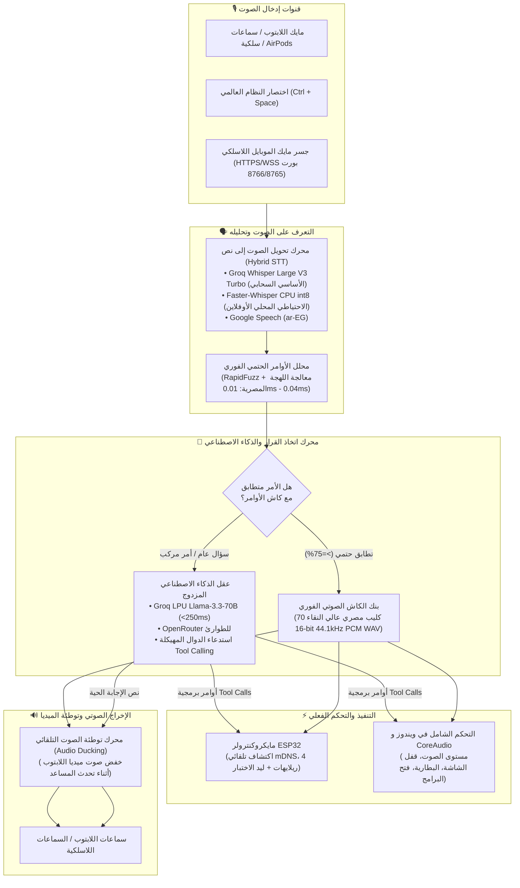

# 🏡 منصة المساعد الصوتي الذكي للمنزل (AI Smart Home Voice Hub `.exe`)

<div align="center">

[](README.md)
[](README_AR.md)

**تطبيق ديسكتوب مكتبي أصيل لويندوز (Native Windows Desktop GUI `.exe`) فائق السرعة، مبني بالعامية المصرية الأصيلة مع نظام الكاش الصوتي مسبق التوليد (Zero-Latency Audio Cache)، واستنساخ الأصوات عبر Fish Speech و CUDA، وعقل ذكاء اصطناعي مزدوج (Groq LPU + OpenRouter)، والتحكم الكامل في هاردوير ESP32 ونظام تشغيل ويندوز.**

[](https://www.python.org/)
[](https://riverbankcomputing.com/software/pyqt/)
[](https://pytorch.org/)
[-76B900?style=flat-square&logo=nvidia&logoColor=white)](https://developer.nvidia.com/cuda-toolkit)
[](https://groq.com/)
[-00ADD8?style=flat-square)](https://github.com/fishaudio/fish-speech)
[](https://www.espressif.com/)
[](LICENSE)

[المعمارية البرمجية](#-المعمارية-البرمجية-للمنظومة) •
[الميزات الرئيسية](#-الميزات-الهندسية-الرئيسية) •
[مواصفات العتاد](#-مواصفات-الجهاز-المُحسّن-له-lenovo-loq) •
[التشغيل السريع](#-طريقة-التشغيل-السريعة) •
[بنك الأصوات المصرية](#-جدول-أوامر-وبنك-الأصوات-المصرية) •
[دليل ESP32](#-دليل-ربط-وبرمجة-esp32) •
[المايك اللاسلكي](#-جسر-مايك-الموبايل-والـ-airpods-المشفر)

</div>

---

## 📖 نبذة عن المشروع

مشروع **AI Smart Home Voice Hub** هو تطبيق ويندوز مكتبي أصيل بنسبة 100% مبني بواسطة **PyQt6** و **Python**، ليعمل كمنصة حوسبة محيطية فائقة السرعة تربط بين نظام تشغيل اللابتوب، ووحدات التحكم في المنزل الذكي (عبر مايكروكنترولر **ESP32**)، ونماذج الذكاء الاصطناعي السحابية والمحلية.

على عكس المساعدات الصوتية التقليدية التي تعاني من بطء ملحوظ (تأخير 1.5 إلى 3 ثوانٍ) في كل أمر بسيط بسبب الاعتماد على توليد الصوت عبر السحابة في كل مرة، يتبنى هذا النظام **محرك صوت مزدوج ذكي**:
1. **الكاش الصوتي مسبق التوليد (Zero-Latency Audio Cache):** تشغيل فوري في **0 مللي ثانية** لـ 70 كليب صوتي مصري عالي النقاء مسجل ومحفوظ محلياً يغطي 27 أمراً روتينياً.
2. **التوليد العصبي الديناميكي الحي:** توليد فوري لإحصائيات اللابتوب (مثل: نسبة شحن البطارية الحالية `67%`، حمل المعالج) والإجابة على الأسئلة الحوارية العامة عبر معالجات **Groq LPU** وموديل **Fish Speech** على كارت الشاشة **RTX 4050**.

---

## 🏛️ المعمارية البرمجية للمنظومة



---

## 🌟 الميزات الهندسية الرئيسية

### 1. تطبيق ويندوز أصيل 100% بدون متصفحات (`.exe`)
- واجهة مستخدم مبنية برمجياً عبر **PyQt6** بنمط الألوان الداكنة العصرية (Dark QSS Theme).
- تكامل تام مع **Windows System Tray** (شريط المهام بجوار الساعة) للعمل الصامت في الخلفية دون استهلاك مساحة الشاشة.
- اختصار لوحة مفاتيح عالمي **`Ctrl + Space`** يعمل في ويندوز من داخل أي لعبة أو برنامج لبدء الاستماع فوراً.
- تجميع كامل في ملف تنفيذي مستقل لا يحتاج بايثون: `dist\SmartHomeVoiceHub\SmartHomeVoiceHub.exe`.

### 2. محرك الصوت المزدوج: الكاش الصوتي والتوليد الحي
- **Zero-Latency Audio Cache:** 70 ملف صوتي بصيغة `.wav` نقية (16-bit 44.1kHz PCM) مقسمة لمجموعات (الإضاءة، التكييف، اللابتوب، الهاردوير، التحيات، الهمس).
- **تنويعات طبيعية عشوائية:** كل أمر يمتلك 3 إلى 5 صياغات مصرية طبيعية مختلفة (مثال: *"تمام يا فندم، نورت الريسبشن"*, *"من عينيا، النور اشتغل"*, *"خلاص فتحتلك النور"*) لكسر الملل.
- **وضع الهمس الليلي التلقائي (Auto Night Whisper):** يتفعل تلقائياً بعد الساعة 12:00 منتصف الليل ليصبح صوت المساعد هادئاً ومنخفضاً.
- **توطئة صوت اللابتوب (Audio Ducking):** خفض صوت الموسيقى والفيديوهات والألعاب إلى 25% تلقائياً عبر Windows CoreAudio أثناء حديث المساعد، واستعادتها فوراً.

### 3. عقل الذكاء الاصطناعي المزدوج واستدعاء الأدوات المهيكلة (Tool Calling)
- **المحرك الأساسي:** معالجات **Groq LPU** الخارقة بموديل `llama-3.3-70b-versatile` بزمن استجابة أقل من **250 مللي ثانية**.
- **المحرك الاحتياطي:** **OpenRouter** بموديل `meta-llama/llama-3.3-70b-instruct:free` كبديل مجاني عند انقطاع الإنترنت السريع.
- **استدعاء الأدوات تلقائياً (Tool Calling):** يفهم الأوامر المعقدة أو المتعددة في جملة واحدة (مثل: *"اطفي نور الصالة واقفل شاشة اللابتوب وظبط التكييف على 22"*) ويقوم باستدعاء دوال التحكم في ESP32 واللابتوب برمجياً في نفس اللحظة.

### 4. محرك هجين لتحويل الصوت إلى نص (Hybrid STT)
- **الأساسي:** Groq Whisper Large V3 Turbo لفهم اللهجة المصرية بأعلى دقة سحابية وسرعة فائقة.
- **الاحتياطي المحلي:** Faster-Whisper على معالج Intel بدقة `int8` للعمل الأوفلاين التام بدون إنترنت.
- **الاحتياطي الثالث:** Google Speech Recognition بالعامية المصرية (`ar-EG`).

### 5. جسر مايك الموبايل وسماعات الـ AirPods المشفر (HTTPS/WSS LAN Bridge)
- بوابة ويب مشفرة خفيفة مدمجة داخل التطبيق تعمل على `https://192.168.100.84:8766` وسوكيت مشفر `wss://192.168.100.84:8765`.
- توليد شهادات أمان SSL ذاتية برمجياً لحل حظر متصفحات Safari و Android Chrome للمايكروفون على عناوين IP غير المحلية.
- تحدث للمساعد من أي موبايل أو سماعة AirPods في أي غرفة في المنزل عبر شبكة الواي فاي المنزلية بدون شراء مايكات إضافية.

### 6. ربط هاردوير ESP32 الفعلي
- **اكتشاف تلقائي mDNS:** التعرف التلقائي على البوردة بالاسم `http://esp32-smarthome.local`.
- **تجربة فورية بدون قطع:** تحكم مباشر في لمبة البوردة الزرقاء المدمجة (`GPIO 2`).
- **تحكم في 4 قنوات ريلاي:** إضاءة الريسبشن (`GPIO 26`)، غرفة النوم (`GPIO 27`)، الأجهزة والمروحة (`GPIO 14`)، الستائر (`GPIO 12`).
- **بديل السيريال USB COM:** يعمل عبر كابل USB مباشرة في حال انقطاع شبكة الواي فاي.

### 7. تحكم عميق في نظام تشغيل ويندوز (Windows OS Control)
- التحكم بمستوى الصوت الرئيسي (رفع، خفض، كتم، أو تحديد نسبة معينة) عبر Windows CoreAudio (`pycaw`).
- التحكم بالميديا (تشغيل / إيقاف مؤقت، المسار التالي / السابق).
- قفل اللابتوب فوراً (`LockWorkStation`) وإطفاء الشاشة لتوفير الطاقة.
- قراءة حية لنسبة شحن البطارية وحالة كابل الشاحن واستهلاك المعالج والذاكرة.
- تشغيل التطبيقات صوتياً (جوجل كروم، سبوتيفاي، فيجوال ستوديو كود، المفكرة).

---

## 💻 مواصفات الجهاز المُحسّن له (Lenovo LOQ)

تم ضبط وتجربة وتخصيص الكود بالكامل لجهاز **Lenovo LOQ 15IAX9**:

| المكون | المواصفات | الاستخدام في المنظومة |
| :--- | :--- | :--- |
| **المعالج** | Intel Core i5-12450HX (8 أنوية / 12 مسار) | تشغيل Faster-Whisper CPU وخادم الشبكة والواجهة |
| **كارت الشاشة** | **NVIDIA GeForce RTX 4050 Laptop GPU (6GB GDDR6)** | **تخصيص 100% من الـ VRAM لـ Fish Speech (`openaudio-s1-mini` fp16 ~3.5GB)** |
| **الذاكرة** | 24 GB DDR5 4800 MHz | كاش الواجهة الرسومية PyQt6 وذاكرة الصوتيات المؤقتة |
| **نظام التشغيل**| Windows 11 Home 64-bit | CoreAudio API ومستمع النظام وشريط المهام |
| **تعريف CUDA** | CUDA 12.4 مع cuDNN 9.x | تسريع معالجة PyTorch 2.6.0+cu124 |

---

## 📁 الهيكل المصدري للمشروع

```
.
├── audio_cache/                    # 70 ملف صوتي بالعامية المصرية عالية النقاء
│   ├── ac_climate/                 # أوامر التكييف 20، 22، 24، والستائر، والشبابيك
│   ├── esp32_hardware/             # ليد الاختبار، المروحة، فحص حالة البوردة
│   ├── greetings/                  # التحيات والاعترافات الفورية والتعريف بالهوية
│   ├── laptop_control/             # الصوت، البطارية، قفل اللابتوب، تشغيل التطبيقات
│   ├── lighting/                   # إضاءة الريسبشن، غرفة النوم، جميع الأنوار
│   └── whispers/                   # ردود الهمس الليلي الهادئة
├── config/                         # الإعدادات وبذور الأصوات المرجعية
│   ├── app_settings.json           # ملف حفظ الإعدادات ومفاتيح الـ API
│   ├── phrases_to_generate.json    # النصوص والتنويعات ومشاعر النطق
│   ├── voice_bank_manifest.json    # خريطة ربط الـ 27 أمراً بـ 70 ملفاً صوتياً
│   └── reference_voices/           # بذور الاستنساخ الصوتي المصرية لـ Fish Speech
│       ├── egyptian_male_ref.wav   # بذرة صوت رجالي مصري استوديو (شاكر)
│       └── egyptian_female_ref.wav # بذرة صوت نسائي مصري استوديو (سلمى)
├── core/                           # مكتبات المنظومة الخلفية
│   ├── audio_ducking.py            # خفض صوت الميديا التلقائي أثناء الكلام
│   ├── audio_player.py             # تشغيل الصوت فائق السرعة عبر Pygame
│   ├── esp32_controller.py         # التحكم في ESP32 عبر الواي فاي والسيريال
│   ├── fish_speech_client.py       # مدير خادم Fish Speech على كارت الشاشة
│   ├── intent_parser.py            # معالج مطابقة الأوامر بالعامية (0.01ms)
│   ├── lan_receiver.py             # خادم مايك الموبايل المشفر عبر HTTPS/WSS
│   ├── laptop_controller.py        # التحكم في ويندوز والصوت والبطارية وقفل الشاشة
│   ├── llm_brain.py                # عقل الذكاء الاصطناعي (Groq LPU + OpenRouter)
│   ├── paths.py                    # إدارة المسارات أثناء التطوير والتشغيل من exe
│   └── stt_engine.py               # محرك تحويل الصوت لنص الهجين
├── esp32_firmware/                 # كود مايكروكنترولر ESP32
│   └── esp32_smart_home.ino        # كود أردوينو كامل مع الواي فاي والـ 4 ريلايهات
├── gui/                            # واجهة PyQt6 المكتبية الأصيلة
│   ├── main_window.py              # النافذة الرئيسية وشريط المهام والاختصارات
│   ├── styles.py                   # ملف التنسيق المظلم العصري (Dark QSS)
│   ├── tab_dashboard.py            # لوحة التحكم التفاعلية وسجل العمليات الحي
│   ├── tab_esp32_devices.py        # إدارة أجهزة ESP32 والتحكم اليدوي والفحص
│   ├── tab_audio_cache.py          # استوديو توليد الأصوات ومراقبة كارت الشاشة
│   └── tab_settings.py             # إعدادات المفاتيح (Groq, OpenRouter, HF)
├── scripts/                        # أدوات واختبارات التطوير
│   ├── generate_reference_voices.py# توليد بذور الاستنساخ الصوتي المصرية
│   ├── pregenerate_voice_bank.py   # توليد الـ 70 ملف صوتي دفعة واحدة
│   ├── setup_fish_gpu.py           # تحميل وتجهيز موديل Fish Speech لـ RTX 4050
│   └── test_all_modules.py         # سكريبت الفحص الشامل لـ 6 منظومات
├── app.spec                        # ملف إعدادات تجميع PyInstaller
├── build_exe.bat                   # سكريبت تجميع التطبيق بضغطة زر إلى exe
├── fish_speech_generator.py        # أداة إعادة توليد الكاش الصوتي من سطر الأوامر
├── main.py                         # نقطة انطلاق التطبيق الرئيسية
├── requirements.txt                # متطلبات حزم بايثون
└── start_fish_server.bat           # سكريبت تشغيل سيرفر Fish Speech على GPU
```

---

## ⚡ طريقة التشغيل السريعة

### المتطلبات الأساسية:
- نظام ويندوز 10 أو 11 (64-bit).
- بايثون 3.10 أو أحدث (تم الاختبار على Python 3.13).
- برنامج Git لويندوز.
- توفر حزمة [FFmpeg](https://ffmpeg.org/) على مسار النظام العام `PATH`.

### خطوات التثبيت والتشغيل:

1. **استنساخ المستودع (Clone):**
   ```bash
   git clone https://github.com/AbdoLailah586/SH_0.git
   cd SH_0
   ```

2. **إنشاء البيئة الافتراضية وتفعيلها:**
   ```powershell
   python -m venv .venv
   .\.venv\Scripts\activate
   ```

3. **تثبيت حزم بايثون الأساسية:**
   ```powershell
   pip install -r requirements.txt
   ```

4. **تثبيت PyTorch المدعوم بكارت الشاشة (CUDA 12.4):**
   ```powershell
   pip install torch --index-url https://download.pytorch.org/whl/cu124
   ```

5. **فحص جميع مكونات المنظومة:**
   ```powershell
   python scripts\test_all_modules.py
   ```

6. **تشغيل البرنامج المكتبي:**
   ```powershell
   python main.py
   ```

---

## 📦 تجميع التطبيق إلى ملف مستقل (`.exe`)

يمكنك تجميع كامل المنظومة داخل ملف تنفيذي مستقل يعمل بدون بايثون بضغطة زر واحدة عبر تشغيل:

```cmd
build_exe.bat
```

سيتم إنشاء الملف المترجم النهائي في:
```
dist\SmartHomeVoiceHub\SmartHomeVoiceHub.exe
```
هذا الملف مستقل تماماً ويحتوي على كافة الملفات الصوتية الـ 70 وتنسيقات QSS وإعدادات النظام.

---

## 🎙️ جدول أوامر وبنك الأصوات المصرية

| التصنيف | مثال الأمر الصوتي بالعامية | الإجراء الفعلي في الهاردوير/النظام | نوع الاستجابة |
| :--- | :--- | :--- | :--- |
| **إضاءة الريسبشن** | *"افتح النور"*, *"نور الريسبشن"*, *"شغل اللمبة"* | تفعيل ريلاي 1 (GPIO 26) | كاش صوتي فوري (0ms) |
| **إطفاء الإضاءة** | *"اقفل النور"*, *"اطفي النور"*, *"ضلم الريسبشن"* | إيقاف ريلاي 1 | كاش صوتي فوري (0ms) |
| **إضاءة غرفة النوم** | *"نور الأوضة"*, *"افتح نور غرفة النوم"* | تفعيل ريلاي 2 (GPIO 27) | كاش صوتي فوري (0ms) |
| **إطفاء غرفة النوم** | *"اطفي الأوضة"*, *"اقفل نور غرفة النوم"* | إيقاف ريلاي 2 | كاش صوتي فوري (0ms) |
| **كل الأنوار** | *"نور البيت كله"*, *"اطفي البيت كله"* | تفعيل / إطفاء جميع الريلايهات الـ 4 | كاش صوتي فوري (0ms) |
| **ليد بوردة ESP32** | *"افتح لمبة الاختبار"*, *"شغل ليد البوردة"* | تفعيل الليد الأزرق المدمج (GPIO 2) | كاش صوتي فوري (0ms) |
| **التكييف والحرارة** | *"شغل التكييف على 22"*, *"خلي التكييف 24"* | ضبط درجة حرارة التكييف في ESP32 | كاش صوتي فوري (0ms) |
| **الستائر والشبابيك**| *"افتح الستارة"*, *"افتح الشباك للتهوية"* | تشغيل محرك الستائر عبر ريلاي 4 | كاش صوتي فوري (0ms) |
| **صوت اللابتوب** | *"علي الصوت"*, *"وطي الصوت"*, *"اكتم الصوت"* | تحكم فوري في Windows CoreAudio | كاش صوتي فوري (0ms) |
| **قفل اللابتوب** | *"اقفل اللابتوب"*, *"اقفل الشاشة"* | استدعاء `LockWorkStation` فوراً | كاش صوتي فوري (0ms) |
| **نسبة البطارية** | *"بطارية اللابتوب كام"*, *"نسبة الشحن كام"* | قراءة نسبة الشحن الفعلية عبر `psutil` | **توليد صوتي ديناميكي حي بنسبة الشحن** |
| **تشغيل الميديا** | *"وقف الأغنية"*, *"شغل الموسيقى"* | تبديل تشغيل/إيقاف مشغلات الوسائط | كاش صوتي فوري (0ms) |
| **فتح التطبيقات** | *"افتح كروم"*, *"افتح سبوتيفاي"*, *"افتح كود"* | تشغيل التطبيق المطلوب على اللابتوب | كاش صوتي فوري (0ms) |
| **وضع الهمس الليلي** | *"وضع النوم"*, *"تصبح على خير يا فندم"* | إطفاء الأنوار والرد بنبرة همس هادئة | كاش همس ليلي (0ms) |
| **أسئلة ودردشة عامة** | *"مين اخترع الكهرباء؟"*, *"قوللي نكتة يا فندم"* | تحليل وتفكير عبر Groq Llama-3.3-70B | **توليد صوتي عصبي حي** |

---

## 📡 دليل ربط وبرمجة ESP32

كود الفيرموير جاهز داخل المجلد: [`esp32_firmware/esp32_smart_home.ino`](esp32_firmware/esp32_smart_home.ino).

### خريطة البنات (Pinout):
- **ليد الاختبار المدمج على البوردة:** `GPIO 2`
- **ريلاي 1 (إضاءة الريسبشن):** `GPIO 26`
- **ريلاي 2 (إضاءة غرفة النوم):** `GPIO 27`
- **ريلاي 3 (المروحة أو الأجهزة):** `GPIO 14`
- **ريلاي 4 (الستارة أو مخرج إضافي):** `GPIO 12`

### خطوات الرفع عبر Arduino IDE:
1. افتح الملف `esp32_smart_home.ino` داخل Arduino IDE.
2. اختر نوع البوردة: **ESP32 Dev Module**.
3. عدل بيانات شبكة الواي فاي المنزلية في السطور 21-22:
   ```cpp
   const char* DEFAULT_SSID = "اسم_شبكة_الواي_فاي";
   const char* DEFAULT_PASS = "كلمة_المرور";
   ```
4. ارفع الكود وراقب شاشة السيريال (Serial Monitor) بمعدل `115200` baud.
5. في تاب **Devices & LAN** داخل تطبيق اللابتوب، اضغط **Ping ⚡** للتحقق من الاتصال التلقائي عبر mDNS.

---

## 🐟 تشغيل Fish Speech المحلي على كارت الشاشة (RTX 4050)

لإبقاء موديل توليد واستنساخ الأصوات دافئاً ومحملاً بشكل دائم في ذاكرة كارت الشاشة (VRAM):

1. شغل سكريبت تجهيز المستودع والأوزان:
   ```powershell
   python scripts\setup_fish_gpu.py
   ```
2. شغل خادم الـ API المحلي:
   ```cmd
   start_fish_server.bat
   ```
3. ستتحول أيقونة الحالة في تاب **Audio Cache** إلى **🟢 متصل (CUDA)**.
4. يمكنك تسجيل عينة صوتية 15 ثانية بصوتك لاستنساخ نبرتك، أو الاعتماد على البذور الصوتية المصرية المرفقة.

---

## 📱 جسر مايك الموبايل والـ AirPods المشفر

للتحدث مع المساعد الصوتي من أي مكان في المنزل عبر مايك هاتفك أو سماعات AirPods المتصلة به:
1. تأكد من اتصال الهاتف بنفس شبكة الواي فاي المتصل بها اللابتوب.
2. افتح الرابط الظاهر على واجهة البرنامج من متصفح الهاتف:
   ```
   https://192.168.100.84:8766
   ```
3. وافق على شهادة الأمان الذاتية المشفرة (SSL) لمرة واحدة.
4. اضغط باستمرار على زر المايكروفون الدائري وتحدث براحتك، وسيصل صوتك للبرنامج فوراً!

---

## 🛡️ الترخيص (License)

هذا المشروع مرخص تحت رخصة **MIT License**. راجع ملف [LICENSE](LICENSE) لمزيد من التفاصيل.

---

<div align="center">
  <sub>تم التطوير بواسطة <b>Abdo Lailah</b>. مصمم لأقصى أداء واستجابة في الحوسبة الذكية المحيطية.</sub>
</div>

